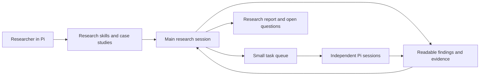

# Math Research Agent · Pi research package

A Pi plugin for long-horizon mathematical research. The product is the research method: focused skills, concrete case studies, durable findings, selective delegation, independent proof review, and readable results. Pi supplies models, credentials, tools, sessions, compaction, and execution.

The previous standalone agent runtime, provider adapters, proof pipeline, Web API and Workbench have been retired. Lean is outside this version's scope. Historical documents and mathematical sources remain under [docs/legacy](docs/legacy/README.md); old benchmark results describe the old implementation.

## Install and use

Requires Node.js 22.19+ and the Pi 1.4.x Node/npm package. Development and integration checks pin Pi 1.4.0. Use your existing Pi model/login configuration; this package has no API-key store, provider catalog, or model adapter.

```sh
npm ci --ignore-scripts
npm run build
npm exec -- pi install --local .
npm exec -- pi
```

Run the install command in the checkout to try it there, or pass the absolute checkout directory from a different research project. For a one-off trial without changing package settings:

```sh
pi --extension /path/to/math-research-agent/dist/extensions/research.js --skill /path/to/math-research-agent/skills
```

Inside Pi:

```text
/research init Determine exactly which parameter range satisfies the proposed bound
/research run --minutes 120 --rounds 20 --workers 2 --task-minutes 20
/research status
/research steer task-ID Check the degenerate case before extending the bound
/research pause Preserve the current lemma and its remaining gap
/research resume
/research report
```

Ordinary Pi conversation remains available: correct a hypothesis, supply a source, ask for an explanation, or redirect the next experiment. Pi's normal steering and queue behavior applies. Escape stops the current operation and pauses an active campaign. The plugin does not automatically resume just because a session was reopened.

`run` starts a fresh explicit budget; `resume` preserves consumed time and rounds. On **resume only**, explicit `--minutes` and `--rounds` add budget. With no options the limits are two hours, twenty research rounds, two parallel tasks, and twenty minutes per task. A round is a research continuation boundary, not a model API request. Pi may use several model/tool turns within a round. Usage is observed separately; this is not a hard dollar/token cap.

The headless entrypoint uses the same plugin, state, and Pi sessions:

```sh
node /path/to/math-research-agent/dist/src/cli.js init 'Investigate this theorem from the local notes'
node /path/to/math-research-agent/dist/src/cli.js run --minutes 30 --model PROVIDER/MODEL
node /path/to/math-research-agent/dist/src/cli.js resume
node /path/to/math-research-agent/dist/src/cli.js status
```

Run these from the research project's working directory. `math-research` is also installed as a bin when installing the npm package. Ctrl+C retains state; `resume` restores the main Pi session and unfinished task sessions. Foreground execution stops when the process stops; there is no daemon or remote service.

## How research works



The main researcher can read, compute and prove directly. A small scheduler runs explicit dependency-ready tasks when an independent proof route, experiment or audit is useful. It does not split problems by text length, insist on fixed roles, or blacklist a mathematical strategy because one proof was incomplete.

The [research charter](prompts/research-charter.md) is short. Pi advertises the seven skills and loads their details when needed:

| Skill | Decision it improves |
|---|---|
| [Orientation](skills/research-orientation/SKILL.md) | What is actually known, and what exact problem are we continuing? |
| [Strategy](skills/research-strategy/SKILL.md) | Which next action will discriminate between plausible routes? |
| [Experiments](skills/mathematical-experiment/SKILL.md) | What can this calculation establish, and what could falsify our intuition? |
| [Proof development](skills/proof-development/SKILL.md) | What is the real missing lemma, and how can we attack it? |
| [Proof audit](skills/proof-audit/SKILL.md) | Which inference could invalidate the conclusion? |
| [Continuity](skills/research-continuity/SKILL.md) | What must survive a break, failed attempt or context boundary? |
| [Synthesis](skills/research-synthesis/SKILL.md) | What is ready to submit, and what must remain an explicit gap? |

Examples include reconstructed decisions from A069862 and automata research, with source links and limits. They teach when to compute, repair an argument, consult a theorem, change route, submit a scoped result or pause. They do not claim to reproduce hidden reasoning or guarantee a theorem is true.

## Inspectable project files

```text
research/
  GOAL.md                    # User-editable objective and assumptions
  PROGRESS.md                # Current findings, bottleneck and next action
  results/<id>/<hash>.md      # Exact captured result bodies
  tasks/<id>/<attempt>.md     # Independent task and review outputs
  REPORT.md                  # Generated overview, links, scope and open work
.math-research/
  state.json                 # Task ledger, result metadata, reviews and budget
  main-sessions/             # Pi's own main-session history
  tasks/                     # Requests, attempts and Pi task sessions
```

Research files hold mathematical content; the small ledger holds scheduling and references. Pi owns conversation history. A result's statement, scope, assumptions and evidence are explicit. Reviews bind the exact body hash and an independent completed task. Changed sources, dependencies, goals, proof bodies or review reports make dependent acceptance stale. Conflicting assessments remain disputed. Revising a proof means capturing a new result, then obtaining a fresh review.

`candidate`, `reviewed`, `disputed` and `stale` describe evidence status. **Reviewed means informal model review, not mathematical ground truth or formal verification.** A completed task only says the execution finished. Finite computations retain their declared range.

The plugin reads local files and uses normal Pi permissions. Separate worker directories prevent accidental concurrent editing by convention; they are not a new OS sandbox. Workers return files for the main researcher to integrate. Configure the host environment appropriately for the project.

## Research tools

These are model-callable operations, not a second planner language:

- `research_task`: enqueue with `title`, `question`, `successCriteria`, optional `kind`, `inputs` and `dependsOn`; `dispatch` ready tasks; `inspect` a saved output; `steer` an active independent task. A `review` task requires `reviewResultId` and captures the exact candidate and sources automatically.
- `research_record`: capture a local result using `path`, `statement`, `scope`, `kind`, assumptions, source paths and result dependencies; or attach a typed review verdict to its completed independent `taskId`. Read the independent report before recording the verdict. No free-text verdict regex is used.
- `research_status`: inspect the project, generate a report, or pause with a specific reason.

Kinds are proof, lemma, counterexample, experiment, obstruction and note. “Submit” in the skills means delivering local research files; publication and external messages require the corresponding user instruction.

Sources must resolve inside the project. To use outside materials, explicitly place or copy the needed source into the project. Read only the relevant files; corpus import and semantic indexing are not prerequisites to beginning research.

## Development and verification

```sh
npm run typecheck
npm test
npm run smoke:pi
npm pack --dry-run
```

The smoke check launches real Pi 1.4.0 processes against a local deterministic endpoint, executes a file tool, resumes a session, checks all seven skills, and runs the headless record/pause/report flow. It uses no paid model or user credentials. It needs permission to bind a temporary localhost port.

Quality evaluation is separate. [Five research scenarios and the three-track runner](examples/evaluation/README.md) compare plain Pi, Pi with skills, and Pi with skills plus orchestration. The runner records failures and actual usage without oracle-selected retries. No improvement in mathematical ability is claimed from the deterministic integration tests. See [validation](docs/VALIDATION.md) for checks actually performed.

The only execution backend in this release is Pi. `ResearchExecutor` is a small execution boundary for task runs, cancellation, progress, session references and usage; there are no speculative Codex/dsh adapters.

## License

MIT. Case studies link to the original mathematical records and are pedagogical summaries rather than copies of entire papers.
